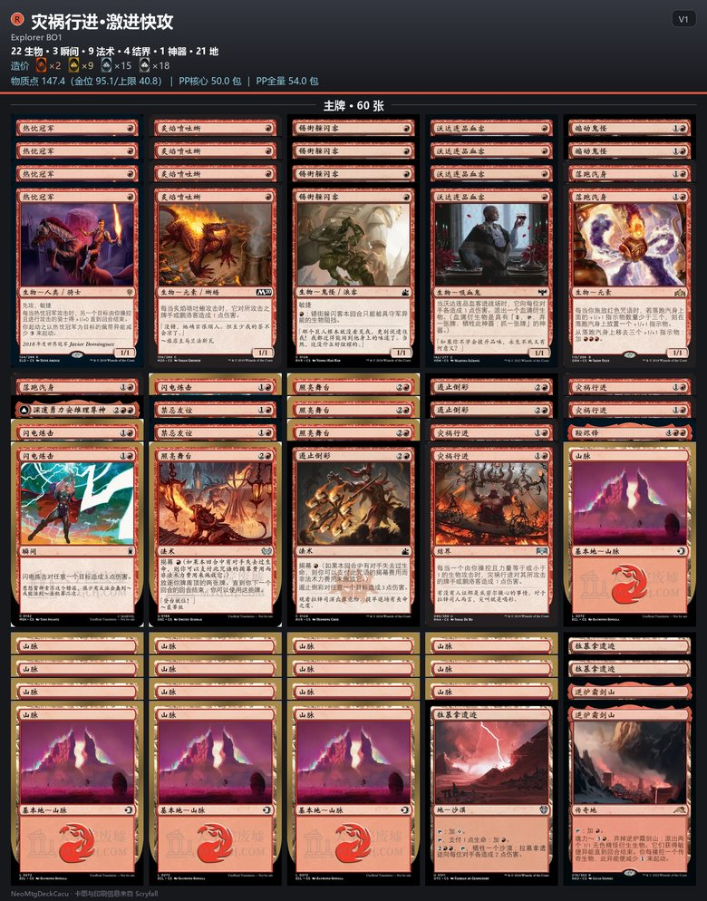

# NeoMtgDeckCacu

万智牌（MTG）套牌研究、构筑与测试工具箱。Python 3.7+，以标准库为主，围绕 MTGA 的
构筑/限制两条竞技主线沉淀工具链与方法论：从环境调研、候选枚举、构筑验证到图文交付，
全流程有对应脚本与文档规范。


## 开发方向

**两条主线**

1. **构筑套牌工作流**——环境基线（Scryfall/MTGCH 检索、合法性、禁牌表）→ 候选枚举 →
   构筑（`deck_pooper.py`）→ 验证（`mtg_tool.py validate`）→ 版本化交付
   （`deck_version.py` + `deck_image.py` 牌表图 + 造价块）。
   特化方向：**标准新手系列**——同一流程在"低造价新手预算"场景的特化，附带造价核算
   （`tools/newbie/deck_cost.py`：造价签名 / 物质点 / PP 包数）与逐套牌金鱼模拟器。
2. **限制赛条线**——售前新系列预览追踪与单卡评分建库（`set_preview_tool.py`）→
   实战轮抓座舱（`mtga_draft_tool.py`：17Lands 锚点、LLM 抓牌建议、评分回归）。

**工具组（支撑）**：MTGA 日志分析/战绩回收/实时建议（`mtga_log_tool.py`、
`mtga_auto_tool.py`、`mtga_db_tool.py`）；Forge 离线对局模拟（`forge_tool.py`，增强内容）。

**交叉能力**：LLM 集成（DeepSeek，轮抓/对局建议）；MTGA 客户端资源提取与图像化交付；
外部参考研究（`Ref/`）。

当前优先强化构筑与可复现评测，覆盖 Standard、Pioneer/Explorer、Historic、Timeless、
Brawl 家族和 Draft/Sealed；Alchemy 不纳入开发范围。Commander 专项交付另有工作流，
不将 Brawl 测试结果直接视为多人 EDH 强度证明。

## 网页工作台与评测

运行 `python tools/deck_workbench.py serve`，打开 [本地工作台](http://127.0.0.1:8644/)。
同一页面支持限制赛与构筑模式，导入牌池/候选、编辑主备牌、查看曲线与色源，
并执行门禁、角色、组合技及造价检查，导出 TXT/PNG。会话保存在内存中，完成后需导出。

- **构筑**：固定种子牌的数量与分区，预留备牌同名额度；模块、节奏和有上限的协同分
  提供逐牌入选依据。协同提示仍需核对规则，不证明某条配合可用。
- **评测**：「核验 → 展开与版本评测」提供后台抽样、旧版对照、95%抽样区间和 JSON 下载。
  任务冻结牌表与牌面，运行期间改牌会标记旧结果过期；也支持纯离线牌面快照。
- **Agent**：可按需连接 Codex 或 Kimi Code CLI 接收端，处理建议与解释请求；
  确定性评测不需要连接模型。

评测目前衡量伦敦调度后的起手和静态土地支付潜力，未模拟横置时序、加速、对手或
MTGA BO1 平滑。`partial` 列出未覆盖项；`complete` 仅表示模型范围内完成，不表示
牌表合法或胜率提升。CLI 用法见[工具手册](tools/README.md)，实现与验证见
[第一批说明](docs/ConstructedEvaluation_20261016.md)和[第二批说明](docs/ConstructedEvaluationBatch2_20261016.md)。

## 交付物示例：牌表图

`deck_image.py` 把 MTGA 导入格式牌表渲染成 Untapped.gg 风格网格图：叠卡切片、类别分组、
中文类型统计，造价行直接使用 MTGA 客户端原生野卡图标（M 红橙 / R 金 / U 冰银蓝 / C 银白），
后附物质点与 PP 包数明细（指标口径见 `MtgDeckCostMetric.md`）。



## 图标资源

`tools/assets/icons/` 下的 `mana/`（法术力符号 46 个：五色 + C/S/X/T/E + 数字 0–20 + 混色）
与 `type/`（Artifact / Enchantment / Land）由 `tools/render_open_icons.py` 用开源 Mana
字体（SIL OFL 1.1，© Andrew Gioia）渲染，许可见 `tools/assets/icons/NOTICE.md`。
`wildcard/` 野卡图标不随仓库分发：本机可用 `tools/extract_mtga_icons.py` 从自己的 MTGA
客户端提取（需 UnityPy），缺失时 `deck_image.py` 造价行自动回退手绘稀有度色块。

## 快速开始

```bash
# 克隆后初始化（目录骨架 + LLM 配置模板；--with-data 联网重建造价快照）
python tools/init_workspace.py

# 回归测试（2026-10-16：894 项通过）
python -m unittest discover -s tools -p "test_*.py"

# 网页工作台（本地端口 8644；无需 LLM 即可组牌、评测）
python tools/deck_workbench.py serve

# 牌表门禁 / 单卡合法性核查
python tools/mtg_tool.py validate deck.txt --format pioneer --bo3
python tools/mtg_tool.py check "Card Name" --format pioneer --platform arena

# 离线一致性评测 / 版本对照（cards.json 为完整候选牌面数组）
python tools/deck_evaluate.py evaluate deck.txt --cards cards.json --format pioneer --out evaluation.json
python tools/deck_evaluate.py compare before.txt after.txt --cards cards.json --format pioneer --out comparison.json

# 造价签名（签名 + 物质点 + PP 包数）
python tools/newbie/deck_cost.py sig deck.txt

# 牌表图（同名 PNG 落入牌表目录）
python tools/deck_image.py deck.txt --title "标题" --format "Explorer BO1" --subtitle "V1"

# Forge 模拟 / MTGA 日志扫描 / 轮抓座舱
python tools/forge_tool.py sim deck-a.txt deck-b.txt --games 20
python tools/mtga_log_tool.py scan
python tools/deck_pooper.py draft --watch --set HOB --llm --port 8643
```

## 给 Agent 用

- **编程类 Agent**（Kimi Code / Claude Code / Codex）：读 `AGENTS.md` + `skills/`
  目录下的 SKILL.md，直接驱动 CLI；Claude Code 入口为 `CLAUDE.md`。
- **聊天型 Agent 客户端**（CherryStudio / WorkBuddy / DeepSeek Harness）：接入
  `tools/mcp_server.py`（零依赖 stdio MCP server，6 个只读工具），配置 JSON 示例见
  `tools/README.md` 的 mcp_server 章节，冒烟自测 `python tools/mcp_server.py --selftest`。

## 文档导航

| 文档 | 内容 |
|---|---|
| `AGENTS.md` | 仓库规范：结构、命令、风格、测试与提交约定 |
| `CONTRIBUTING.md` | 贡献指南：反馈通道、PR 要求、升级方式 |
| `CHANGELOG.md` | 版本变更记录 |
| `skills/` | Agent 技能权威源（构筑、系列评测、限制赛、规则查询、组合技、指南核验与工作台桥） |
| `tools/README.md` | 工具手册：每个脚本的口径与用法 |
| `MtgDeckCacuWorkFlow.md` | 构筑工作流（阶段 0–5 全流程规范） |
| [Commander/Brawl 双版交付整理](docs/CommanderBrawlWorkflowNotes_20261016.md) | 本次流程、技能、现有工具及6个案例脚本的索引与复用边界 |
| [GitHub MTGA跨赛制调研](docs/GitHubMtgaReferences_20261016.md) | 构筑、限制赛、实战分析与模拟测试；已有迁移和能力缺口 |
| [构筑与评测第一批](docs/ConstructedEvaluation_20261016.md) | 加权色源、伦敦调度修正、离线一致性评测和版本比较 |
| [构筑与评测第二批](docs/ConstructedEvaluationBatch2_20261016.md) | 固定主备牌约束、可追溯协同评分、网页后台评测与版本对照 |
| [GitHub 指挥官专题](docs/GitHubCommanderReferences_20261016.md) | Commander配套交付的仓库、许可证与借鉴位置 |
| `MtgSetReviewWorkFlow.md` / `MtgSetReviewTemplate.md` | 新系列评测工作流与模板 |
| `MtgDeckCostMetric.md` | 造价指标定义的唯一权威来源（签名/物质点/PP、MRUC 视觉方案） |
| `DeckPooperDesign.md` | deck_pooper 设计文档 |
| `MtgWorkbenchPlan.md` | 网页工作台（deck-forge 引入）开发计划 |

## 数据与版权

本地产出（`DeckList/`、`MatchRecord/`、`AuditReport/`、`SimResult/`、`SetReview/`、
`tools/cache/`、`tools/data/` 等）一律 gitignored 不入库；克隆后跑
`python tools/init_workspace.py` 补目录骨架与 `tools/llm_config.json` 模板
（`--with-data` 联网重建造价快照）。

项目代码以 MIT 发布（`LICENSE`）。图标素材见 `tools/assets/icons/NOTICE.md`：
法术力/类型符号由 Mana 字体（SIL OFL 1.1，© Andrew Gioia）渲染；野卡图标不随仓库
分发，本机可用 `tools/extract_mtga_icons.py` 提取，缺失时自动回退手绘色块。
卡图与符号形象版权归 Wizards of the Coast 所有，仅限本项目研究用途；
本项目为非营利粉丝工具，与 WotC 无关联。
